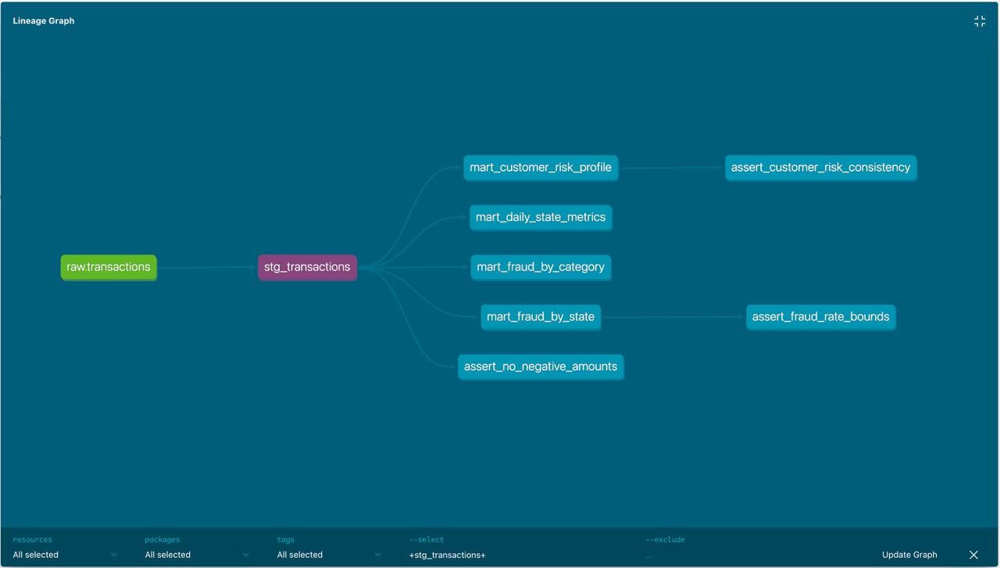

# Домашнее задание. Введение в dbt.

## Технологии

- ClickHouse 25.8
- dbt-core 1.12.6
- dbt-clickhouse 1.10.3
- dbt_utils, dbt_date, Elementary

Версии dbt-пакетов зафиксированы в `dbt/packages.yml`.

## Структура проекта

- `data/` — исходный CSV с транзакциями
- `clickhouse/` — SQL для создания таблицы
- `dbt/models/staging/` — подготовка данных
- `dbt/models/marts/` — аналитические витрины
- `dbt/macros/` — пользовательские макросы
- `dbt/tests/` — дополнительные SQL-тесты

## Аналитические витрины

1. `mart_daily_state_metrics` — дневные метрики по штатам.
2. `mart_fraud_by_category` — анализ мошенничества по категориям.
3. `mart_fraud_by_state` — географический анализ фрода.
4. `mart_customer_risk_profile` — оценка риска клиентов.

## Запуск

**1. Клонирование репозитория**

```bash
git clone https://github.com/kvrnka/mlop_hw4.git
cd mlop_hw4
```

**2. Запустить ClickHouse:**

```bash
cp .env.example .env
docker compose up -d
```

Указать пароль в `.env`.

**3. Создание базы данных и таблицы**

Структура базы описана в файле `clickhouse/create_table.sql`.

Из корня репозитория выполнить:

```bash
docker compose exec -T clickhouse sh -c \
'clickhouse-client --user "$CLICKHOUSE_USER" --password "$CLICKHOUSE_PASSWORD" --multiquery' \
< clickhouse/create_table.sql
```

В результате должна создаться таблица `transactions`.

**4. Загрузка транзакций в ClickHouse**

Разместить исходный датасет в папке data/ под названием transactions.csv.

Выполнить из корня репозитория:

```bash
docker compose exec -T clickhouse sh -c \
'clickhouse-client --user "$CLICKHOUSE_USER" --password "$CLICKHOUSE_PASSWORD" --date_time_input_format=best_effort --query "INSERT INTO transactions_db.transactions FORMAT CSVWithNames"' \
< data/transactions.csv
```

**5. Установить dbt:**

```bash
python3 -m venv .venv
source .venv/bin/activate
pip install dbt-core==1.12.6 dbt-clickhouse==1.10.3
```

**6. Запустить проект:**

```bash
set -a
source .env
set +a

cd dbt
dbt deps
dbt build --select package:fraud_dbt --profiles-dir .
dbt test --select package:fraud_dbt --profiles-dir .
```

**7. Сгенерировать документацию:**

```bash
dbt docs generate --profiles-dir .
dbt docs serve --profiles-dir . --port 8085
```

Документация доступна по адресу `http://localhost:8085`.



## Тестирование

Реализованы стандартные тесты `not_null`, `unique`, `accepted_values`, тесты `dbt_utils` и собственные SQL-тесты для проверки корректности транзакций и рассчитанных метрик.

## Архитектура

`raw.transactions -> stg_transactions -> marts`

Все аналитические витрины строятся на основе подготовленных транзакций через `ref()`.
